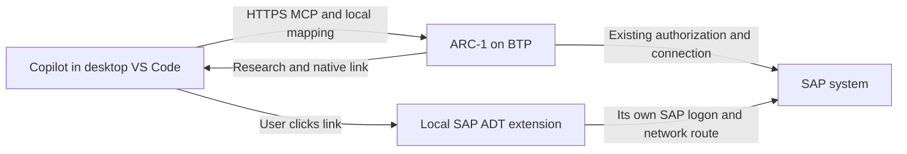

# Native ADT links from a BTP ARC-1 deployment

Research: 2026-10-18, continuing [PR #1025](https://github.com/arc-mcp/arc-1/pull/1025).
The user's intended deployment is BTP. The current stdio-only implementation is therefore a
navigation proof, not completion of that deployment requirement.

## Conclusion

A BTP server can return the same native `vscode://sapse.adt-vscode/open?abapUri=…` link as a local
server. Clicking is handled on the developer's computer. There is no requirement for BTP to open
an inbound connection to VS Code, run a local ARC-1 process, or obtain the local SAP MCP token.
The current HTTP refusal is an ARC-1 guardrail around an unresolved mapping contract, not a BTP
or MCP limitation.

For the near-term core feature, use an explicit **per-connection, per-request IDE mapping** sent
by VS Code with its remote MCP request. Resolve it against the server's already selected target,
then use the existing qualified filename/link generator. Keep SAP's canonical local resolver as
the preferred path to investigate for editor identity and broader object coverage; its availability
must not block basic BTP navigation.



## Gaps in the current draft

| Gap | What must change or be qualified |
|---|---|
| HTTP blocked in configuration and decoration | Replace the blanket transport refusal with a server opt-in plus validated request-scoped presentation context |
| One server-global `ideDestination` | Each developer/workspace supplies its own mapping; never reuse the first caller's alias |
| Multiple SAP targets and clients | Bind to the authorized public target including client; a target can contain an admin route alias rather than its real SID |
| Stateless requests | Do not rely on `initialize`, `clientInfo`, roots, a sticky process, or a login-time registration; carry preferences on each call |
| Independent local connection | ADT must have the correct destination, SAP access and a working network route; Cloud Connector access from BTP does not give the laptop a route |
| Editor identity | Flat and tree URIs may open two editors for the same object; dirty-buffer reuse, edits, save, Keep/Undo and activation remain separately unqualified |
| Live enterprise route | Verify custom headers through the actual CF/proxy route, two users/workspaces and target-specific authorization; no BTP deployment was changed in this research |

The BTP Destination name, public ARC-1 target ID, SAP SID/client, and local ADT alias are different
identifiers. Two servers can expose identical target IDs for different landscapes. Scope a mapping
to the configured MCP server URL/profile as well as its target; never maintain a global SID-to-alias
map. Neither a caller-supplied alias nor a workspace folder proves backend correspondence.

## Available implementation paths

| Path | BTP suitability | Qualification and trade-off |
|---|---|---|
| **Request-scoped headers + core native link** | Recommended initial implementation | No custom bridge or local SAP MCP dependency for navigation; retains flat-URI limitations |
| **Cloud ARC-1 + local SAP MCP resolver in Copilot** | Promising complementary path | Can yield canonical tree URIs without teaching BTP local aliases; requires available native tools, correct mapping and a reliable agent handoff |
| Standardized alias on every workstation | Use the same client-header template for the team | No separate server-global HTTP alias: clients without IDE preferences should receive no links |
| Small local bridge resolving neutral object references | Deterministic fallback if needed | Requires an installed companion; current bridge handler is not target-bound and must not be reused unchanged for multiple targets |

Existing bridge `registerUriHandler` calls `openObject`/`showChanges` by name/include/package and
workspace tree. It has no explicit cloud-service/target binding in that handler. Its established
validation and editable-diff features are separate from the small resolver role described here.

### Recommended request contract

This is a **proposal**, not a shipped header or supported configuration.

1. The administrator enables IDE presentation on the HTTP server. Default remains off.
   `ARC1_IDE_DESTINATION` remains a stdio-only setting and is rejected under HTTP; an HTTP
   request gets an alias only from its own valid preference.
2. A VS Code MCP server entry carries a versioned, bounded preference header on each request.
   A concrete candidate after review is `Arc1-Ide-Destinations-V1`, with entries such as
   `A4H/001=DEV-001,A4H/100=QA-100`. Use the full public target exactly, not an inferred SAP SID
   or normalized display label. A bare alias can serve a genuinely single-target `/mcp` connection;
   it must never act as a fallback for pinned/aggregate multi-target routing.
3. Percent-encode each alias as one UTF-8 component and decode exactly once before applying
   `isIdeDestination`. For example, a space becomes `%20`. Propose a 4 KiB encoded-header limit
   and at most 32 entries; these bounds still require qualification against the actual BTP route.
   Reject malformed encodings and oversized input. The alias grammar excludes `,` and `=`, so
   comma-separated entries can handle the SDK's joined duplicate header values. Identical duplicate
   keys may collapse; conflicting values must suppress that key, never silently use the last value.
   Reject unknown versions. Encoding is not encryption or authentication. The spike uses a
   base64url JSON envelope to test transport, not this proposed production parser.
4. Authenticate, authorize and resolve the SAP target using existing ARC-1 rules. Only afterward
   select the mapping for that exact target. Header values must never change SAP URL, BTP
   Destination selection, target grants, scopes, identity or package policy.
5. Decorate only successful qualified research results, preserving original source/JSON blocks.
   Label both the server-selected target and local alias. Retain the eight-link limit and
   current-source semantics. Missing, malformed, unmatched or unsupported preferences yield
   the original result without an IDE link.
6. Keep preferences request-local. Do not store personalized links in source caches, carry them
   across users/workspaces, forward the header to SAP, or log its raw value. No credentials belong
   in the preference or the generated link.

Pinned and aggregate endpoints should share the same selected-target lookup in one implementation.
A pinned target URL is the easiest first live check, followed by aggregate routing; this is a test
sequence, not a reason to postpone aggregate support. Never inherit a single alias across targets.

The user must confirm the mapping corresponds to their actual local connection. Header validation
prevents accidental protocol/path injection but cannot prove the laptop's configured backend.
A local resolver/companion could later verify correspondence; URL equality alone is unreliable
when BTP uses Cloud Connector virtual hosts and ADT uses another network address.

### Concrete code touch points

- `src/server/config.ts`: HTTP opt-in semantics instead of the current blanket refusal; keep
  off-by-default behavior. A server-global alias is insufficient for general HTTP use.
- `src/server/server.ts`: `CallToolRequestSchema` receives `extra.requestInfo.headers` already.
  Parse bounded presentation metadata and resolve it after `prepareMultiTargetCall`; propagate
  only validated presentation context to decoration. No new LLM tool argument is necessary.
- `src/server/ide-links.ts` and `src/handlers/dispatch.ts`: separate qualified link construction
  from stdio/HTTP policy; preserve normalized arguments, success checks and hyperfocused behavior.
- `src/server/multi-target-runtime.ts`: runtime configurations intentionally start from defaults
  plus an allowlist. Explicitly inherit only the admin presentation ceiling (`ideLinks`), never the stdio
  alias (`ideDestination`); do not spread base config or let the header expand it. Never treat a destination name as an IDE alias.
- `src/server/http.ts`: verify the actual BTP/proxy path. Desktop VS Code is the initial client;
  do not expand CORS for this feature. The existing allowlist excludes a new IDE header, so
  browser-origin support would need separate qualification and a narrowly scoped change.
- `src/server/context.ts`: only needed if the chosen implementation carries presentation in
  AsyncLocalStorage. Nested contexts copy explicit fields, so inheriting it requires tests.
  The SDK header path means session registration or an HTTP context change is not inherently needed.

## What was tested

A reproducible local transport spike is in
[`scripts/spikes/adt12-http-ide-links.mjs`](../../scripts/spikes/adt12-http-ide-links.mjs).
Run after building:

```sh
npm run build
node scripts/spikes/adt12-http-ide-links.mjs
```

It uses the installed MCP SDK's HTTP client and ARC-1's actual `createMcpHandler`, with a synthetic
read tool and the built native link generator. It does **not** change the production dispatcher or
simulate SAP authorization. Seven clients concurrently made two tool calls each (14 total):

- Two workspace aliases remained independent on repeated calls after initialization.
- Unicode/spaced aliases survived the encoded header and nested URI round trip.
- Missing preferences, malformed data, a different SAP client and an invalid alias returned no link.
- Original source/evidence blocks remained unchanged.
- A separate assertion confirmed current PR code still refuses HTTP decoration.

All checks passed. There were **zero SAP requests**, no credential use, no persistent listener,
and no BTP deployment. This proves the SDK/ARC-1 HTTP boundary can carry per-request metadata;
it does not prove a CF proxy forwards it, Copilot sends this proposed header, or ADT opens every
accepted alias. The earlier live checks cover native link rendering/opening for the tested alias.

## Claude architecture review

Claude Code Opus 5.5 with Max effort reviewed the design; runtime metadata confirmed the model.
It agreed that request-scoped aliases are the practical core path and that canonical resolver
composition remains a separate, unqualified editing direction. The review sharpened the proposal:

- Gate on alias provenance: stdio config versus HTTP request, under the server opt-in.
- Implement pinned and aggregate target lookup together; avoid a second feature phase for the same map.
- Use client configuration even for a team with one standardized alias; reject a global HTTP alias.
- Specify header encoding, duplicates and bounds; keep desktop navigation separate from browser CORS.
- Treat local target correspondence as unproven until the actual ADT workspace is checked.

The reviewer suggested following existing request-context propagation. Subsequent/direct SDK evidence
in the spike confirms `extra.requestInfo.headers` is also available, so the precise propagation
choice can remain small and explicit. Either path needs nested-context and no-forwarding tests.

## Acceptance checks before enabling BTP support

- Exercise the real configured VS Code remote MCP entry through the BTP route; verify headers are
  present on `tools/call`, including reconnects and after a CF instance restart.
- Use two users and two workspaces with different aliases; interleave calls and verify no preference
  or personalized link crosses requests. Repeat across multiple CF instances if deployed that way.
- Test pinned and aggregate targets, same SID with different clients, route aliases, duplicate SID
  landscapes, unknown targets and stale/wrong mappings. Unauthorized targets must still be denied
  before any link or target details are returned.
- Test malformed/duplicate/oversized headers, Unicode encoding, no mapping and server opt-out.
  Assert zero extra SAP requests and unchanged source/JSON, CLI behavior and tool schemas.
- Confirm scopes, principal propagation, source-cache isolation, audit redaction and target drift
  checks remain effective. A navigation preference grants no access.
- Click a link from an actual remote ARC-1 tool result in Copilot, using a connected local ADT
  destination. Verify target/client and file contents. No source edit is needed for navigation proof.
- Qualify canonical resolver/dirty-buffer/edit/save behavior separately for COMPAT-20.

## Sources and current limits

- [VS Code MCP configuration reference](https://code.visualstudio.com/docs/agents/reference/mcp-configuration):
  custom HTTP headers and configuration formats. The current docs distinguish portable Copilot
  configs from VS Code-specific configs and warn that interactive `${input:…}` entries are not
  forwarded to Copilot harness sessions. Use non-secret literal preferences in the actual supported
  profile format; leave existing OAuth configuration intact and test the user's client variant.
- [SAP's ADT MCP setup tutorial](https://developers.sap.com/tutorials/abap-dev-adt-mcp-server-tools):
  the native MCP server runs locally inside ADT, requires an active workspace destination, and is
  consumed by the local coding agent. Installed 1.2 manifest also describes its generated bearer
  token; that token must stay local.
- [Prior native-link evidence](2026-10-17-adt12-native-ide-links.md): installed 1.2 URI handler,
  AFF mapping, canonical MCP resolver classes, live Copilot opening and remaining qualifications.
- Installed SDK `webStandardStreamableHttp` passes HTTP headers in `requestInfo`; the spike verifies
  this through ARC-1's real stateless wrapper. ARC-1 `multi-target-identity.ts` distinguishes public
  route aliases from real SAP SID/client.

SAP's `abap_object_get_file_uri` and `abap_object_list_file_uris` were found in the installed 1.2
language-server jars, but not in the tested Copilot tool inventory. Re-establish their availability
before using them as the primary workflow. BTP research plus a preconfigured local native link can
already be composed manually by an agent, but the current core does not automatically produce
HTTP links and a guessed mapping is not an acceptable product workflow.
