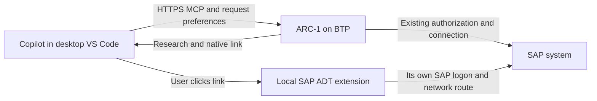

# Native ADT links from a BTP ARC-1 deployment

Implementation and verification: 2026-10-18, [draft PR #1025](https://github.com/arc-mcp/arc-1/pull/1025).
This continues the [ADT 1.2 investigation](2026-10-17-adt12-native-ide-links.md).

## Result

ARC-1 now supports request-scoped native IDE links over HTTP, including BTP pinned and aggregate
routing. The administrator enables the feature; the caller explicitly opts into VS Code presentation
and supplies a map for its own workspace. Other callers receive unchanged output.

The core implementation and real HTTP routing tests pass. A real Copilot → HTTP ARC-1 → SAP read →
clickable link → native ADT editor flow also succeeded locally. Cloud Foundry staged the candidate,
but the account's route and memory quotas prevented starting an isolated application. **Live BTP
runtime, public-router forwarding and OAuth/Copilot acceptance are still unverified.**

BTP does not need an inbound laptop connection or the local native SAP MCP token. The BTP Destination
name, public target ID, SAP SID/client and local ADT alias are distinct identifiers. Two services can
expose identical target IDs for different landscapes. The map belongs in each MCP connection's VS Code
configuration, never a global SID registry. ARC-1 cannot verify a laptop alias's actual backend.

## Implemented contract

- Administrator: `ARC1_IDE_LINKS=vscode` (default `off`). `ARC1_IDE_DESTINATION` is stdio-only;
  HTTP startup rejects it, including when links are disabled.
- HTTP caller: `Arc1-Ide-Client: vscode` and
  `Arc1-Ide-Destinations-V1: A4H/001=DEV-001,A4H/100=QA-100,A4H-2025/001=NEW-001`.
- Match the **already authorized and selected public target exactly**, including SAP client and
  administrator route alias. Pinned and aggregate use the same implementation. `@single=DEV-001`
  is allowed only on a traditional single-target `/mcp`, never as a multi-target fallback.
- Encode each alias with `encodeURIComponent`. Decode once, then validate the existing bounded local
  alias grammar. Header: printable ASCII, ≤4096 bytes, ≤32 entries. Identical duplicate keys collapse;
  conflicting values permanently suppress that key. Invalid entries invalidate the optional map.
- Missing, malformed, oversized, unsupported or unmatched preferences mean **no additional link**,
  never a failed SAP operation. A `v2` header alone does not enable the `v1` contract.
- Append at most eight qualified links after successful reads/search/reference evidence. Preserve
  original source/JSON blocks. No extra SAP calls, new tools, schema properties or scopes.
- Preferences never influence routing, Destination lookup, identity, authorization or safety. No
  personalized state is retained, cached, or forwarded to SAP. Decoration happens after audit;
  nested hyperfocused dispatch defers presentation until after the outer audit too.

The user-facing setup and examples are in [IDE integration](../../docs_page/ide-integration.md).

### Showing links only in VS Code

The service requires an explicit `vscode` preference and matching map on **each tool call**. A VS Code
user-agent alone, a different client marker, a mapping alone, or initialization metadata is insufficient.
Ordinary Claude Desktop, Codex and automation clients therefore receive no IDE links.

This is a presentation preference, not client authentication. A different program can deliberately
copy the headers. MCP supplies no trusted attestation of the application displaying the result.
Use VS Code's workspace/profile configuration, not a portable file shared with other agents. For local
stdio, put the opt-in variables only in VS Code's server entry; a shared environment deliberately
opting other clients in will also show links. CLI exports explicitly suppress them.

Desktop VS Code is the initial scope. This change does not expand browser CORS or qualify VS Code
Insiders/browser-hosted agents. Literal non-secret preferences work independently of existing OAuth.

## Implementation boundaries

| File | Responsibility |
|---|---|
| `src/server/ide-request.ts` | Bounded, stateless header parser and exact target lookup |
| `src/server/server.ts` | Obtain SDK `extra.requestInfo.headers` after target preparation; pass only selected presentation context |
| `src/server/multi-target-runtime.ts` | Inherit only the administrator switch; never inherit a local alias |
| `src/server/ide-links.ts` | Existing qualified AFF mapping and encoded URI sink; verify presentation target matches active config |
| `src/handlers/dispatch.ts` | Decorate successful results after the target guard and terminal audit |
| `src/server/config.ts` | Separate stdio alias requirements from HTTP opt-in |

No HTTP context/session registry, sticky routing, database, native SAP token exchange or model-supplied
alias argument is needed. The scope ∧ safety ∧ SAP authorization invariant remains unchanged.

## Automated verification

Feature implementation `acdbc6bd`: `npm test -- --maxWorkers=1` passed **331 files / 9,338 tests**,
no failures or skips. After merging current main (#1008) into `dbb32dec`, the expanded suite passed
**9,402 / 9,403 tests**; one existing shutdown subprocess missed its startup deadline. All **12
shutdown tests passed** on an isolated rerun of that same merged build. Earlier concurrent full runs
also hit subprocess startup deadlines. No assertions or timeouts were weakened.

Typecheck, lint, policy validation, build, file/schema budgets, the 14-call HTTP smoke and strict
MkDocs passed again on the merged build. The only merge conflict combined request-header and
cancellation-signal fields in a test helper; both are preserved. CI status is tracked in the PR.

`tests/unit/server/ide-request.test.ts` covers exact client/route alias matching, Unicode and spaces,
server/client opt-outs, wrong clients, duplicate/conflicting keys, invalid and double encodings,
limits, unsupported versions, `@single` isolation and wrong-target context refusal at the sink.

`tests/unit/server/ide-links-http.test.ts` exercises real Express routes, bearer middleware, SDK
transport, server creation, authorization projection and dispatch. XSUAA verification, Destination
Service and SAP responses are deterministic fixtures, not live services. Tests cover:

- 24 interleaved reads in each of `standard` and `xsuaa-attribute` authorization modes, across two
  verified users, two endpoint kinds and three targets: two clients of the same SID, plus a separate
  landscape using a route alias. New SDK server/transport objects are created per HTTP request,
  proving that initialization/session affinity is unnecessary.
- No preference persistence on a later call by the same user, and no links without explicit opt-in.
- Unicode decoding, conflicting mappings, no single-target fallback, and administrator opt-out.
- Target grants and scope denials; pinned unauthorized targets retain HTTP 404, and insufficient
  read scope retains HTTP 403. Preferences never expose denied targets.
- Runtime Destination drift refusal before source access/presentation.
- Traditional single-target `/mcp` with API-key and JWT authentication; unauthorized requests stay
  denied and `@single` cannot be replaced by an arbitrary multi-target key.
- Actual duplicate HTTP header lines: equal mapping entries collapse, conflicting entries suppress
  the link, and a repeated client marker is refused.
- One source request per successful read; no preference headers/aliases in SAP calls or audit previews.

The shared-Basic server tests additionally verify separate aliases over pinned/aggregate calls without
changing the existing authentication canary/lockout contract. Dispatcher tests cover HTTP and stdio,
hyperfocused normalization, audit isolation, no additional SAP calls and post-dispatch target refusal.

The optional transport smoke in `scripts/spikes/adt12-http-ide-links.mjs` now calls the production
parser/decorator (the earlier research spike used a provisional JSON envelope). It repeats 14 calls
from seven concurrent SDK clients through ARC-1's actual HTTP wrapper, with a synthetic source tool.
No credentials or SAP requests are involved. Run after `npm run build`.

## Live SAP and Copilot verification

2026-10-18, desktop VS Code 1.142 with SAP ADT 1.2.0, a4h SAP_BASIS 758, local alias
`A4H2023-2`. The compiled working tree was based on `cfe6b504` plus the HTTP implementation below;
the later hyperfocused audit fix was verified with automated regression tests.

1. Started the compiled candidate on loopback with a temporary viewer API key, the existing SAP
   connection, all mutations/data/SQL disabled, and cache disabled. A temporary VS Code-only HTTP
   entry supplied `Arc1-Ide-Client: vscode` and `@single=A4H2023-2`.
2. Read `CL_ABAP_TYPEDESCR` four times: no preferences; VS Code user-agent only; map without opt-in;
   both valid preferences. Only the last returned a second text block with one link. Source bytes
   were identical (SHA-256 `631ff0819d097f18752a7cab744dc95b61fc6ce76282857012d5ec4b4eff58f0`).
3. In a separate Copilot chat, explicitly selected the temporary HTTP server's `SAPRead` tool.
   Copilot returned its exact native link. Clicking invoked SAP ADT's normal URI confirmation.
4. The first click encountered an expired/disconnected ADT session. After normal browser logon,
   the same Copilot link loaded `cl_abap_typedescr.clas.abap`; the editor visibly displayed the class
   definition and RTTS source. No SAP edit, save, activation or transport action was performed.

This verifies real VS Code custom-header delivery and rendering, HTTP source preservation and native
opening. It does **not** qualify BTP OAuth or CF proxy forwarding. The temporary MCP entry, local
listener and viewer key are cleaned up after the test.

## Cloud Foundry attempt and remaining acceptance

After the user refreshed CF authentication, preflight found ten active routed apps. An isolated
`arc1-ide-1025` candidate reused the existing XSUAA/Destination/Connectivity services with read-only
settings. Public-route creation was rejected by the route quota. A second attempt without a route
successfully staged the compiled bundle on Node 24.19.0, but application startup was rejected by the
memory quota. Recorded org usage: **10 routes, 10 started instances, 4096 MiB**.

The stopped candidate was deleted, removing its temporary bindings; existing services, destinations,
roles, routes and applications were not modified. No existing app was stopped to free capacity.
Do not count the successful staging as a live BTP runtime test.

Resume COMPAT-19 when isolated CF capacity is available:

- Deploy the reviewed candidate, verify XSUAA OAuth with the real Copilot HTTP connection, and read
  over both pinned and aggregate routes through the public CF router.
- Verify custom-header forwarding across reconnects/restarts; interleave two workspaces/users.
- Exercise matching/wrong/absent mappings, same SID with distinct clients and route aliases, target
  authorization denials, and native opening on a connected local ADT destination.
- For PP-only deployments that use multiple instances, qualify requests across instances. Shared
  Basic mode retains its existing one-instance constraint; do not scale it for this test.

## Review and wider gaps

Claude Code Opus 5.5 at Max effort independently reviewed the implementation (runtime model identity
confirmed). It found one low-severity issue: hyperfocused nested dispatch could expose local aliases
in the outer terminal audit. The fix defers all presentation until after both audits. Regression tests
assert aliases are absent from every audit and outbound SAP call, with exactly one final link block.
Its suggested authentication-mode, raw duplicate-header, single-target HTTP, shared-Basic and target
guard checks were added. Its follow-up confirmed the fix and found no remaining concrete defects.
Two speculative follow-up notes were checked against the source: the shared normalizer already
strips empty include values, no config-identity cache was found, and no dead IDE field remains in
`ToolDispatchContext`. The reviewer did not execute tests; the test results here are separate evidence.

Earlier architecture review recommended request-scoped presentation, alias provenance, exact public
target matching, and keeping browser CORS outside this feature.

The local ADT connection still needs its own SAP logon and network path. Cloud Connector access from
BTP does not provide laptop connectivity. Flat URIs can open a second editor beside an existing dirty
repository-tree URI. Keep/Undo, validation, editable active/inactive diffs, save, transport assignment
and activation remain COMPAT-20/bridge work, not consequences of navigation support.

The native `abap_object_get_file_uri` / `abap_object_list_file_uris` resolver classes were inspected in
ADT 1.2 jars but unavailable in the earlier Copilot inventory. Investigate canonical editor identity
separately; it does not block this header-based navigation path. Existing bridge handlers resolve
names/includes without a cloud-target binding, so reviving old bridge URLs is not a safe multi-target
fallback.

## Sources

- [VS Code MCP configuration reference](https://code.visualstudio.com/docs/agents/reference/mcp-configuration):
  HTTP headers and configuration locations. Interactive input-dependent entries are not forwarded
  to Copilot harness sessions; use the supported profile with literal non-secret preferences.
- [SAP ADT MCP setup tutorial](https://developers.sap.com/tutorials/abap-dev-adt-mcp-server-tools):
  the native MCP service is local and needs an active workspace destination; its bearer token stays local.
- [Earlier native URI inspection/live evidence](2026-10-17-adt12-native-ide-links.md): AFF names,
  supported includes, namespace encoding, resolver inventory and remaining qualifications.
